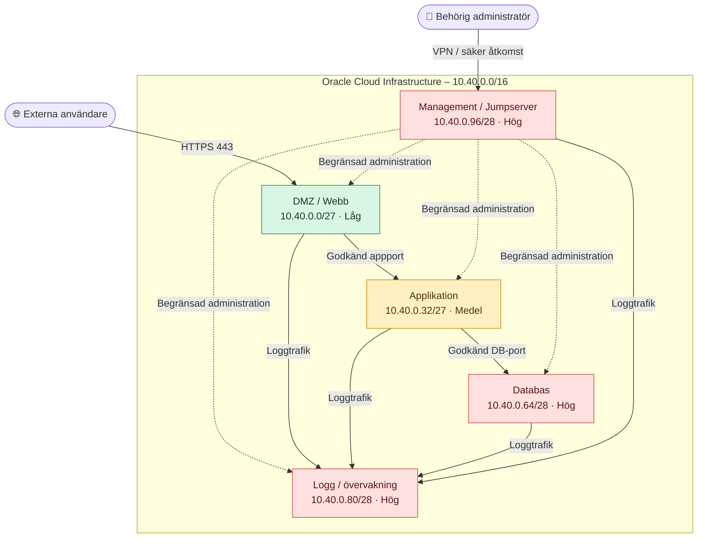

# Säkerhetsklassning och nätverkszoner

> **Projekt:** Nätverksdesign i Oracle Cloud Infrastructure (OCI)  
> **Datum:** 2026-10-15  
> **Version:** 1.0  
> **Adressrymd:** `10.40.0.0/16` · IPv4  

## Del 1 – Klassificering av tillgångar

| Klass | Betydelse |
|:--|:--|
| 🟢 **Låg** | Publik funktion med begränsat skyddsbehov för informationen. |
| 🟡 **Medel** | Intern funktion där obehörig åtkomst kan påverka verksamheten. |
| 🔴 **Hög** | Känsliga uppgifter eller privilegierad åtkomst som kräver starkt skydd. |

| Tillgång | Subnät | Klass | Motivering |
|:--|:--|:--|:--|
| Webbserver | `10.40.0.0/27` | 🟢 Låg | Webbservern publicerar information externt, men ska ändå skyddas mot intrång. |
| Applikationsserver | `10.40.0.32/27` | 🟡 Medel | Applikationen utför verksamhetslogik och ska inte nås direkt från internet. |
| Databasserver | `10.40.0.64/28` | 🔴 Hög | Databasen kan lagra känslig information och ska endast nås av godkända tjänster. |
| Loggserver | `10.40.0.80/28` | 🔴 Hög | Loggar kan innehålla känsliga uppgifter och behövs för att upptäcka incidenter. |
| Jumpserver / administration | `10.40.0.96/28` | 🔴 Hög | Administrationsåtkomst kan ge kontroll över andra servrar och kräver strikt behörighetskontroll. |

**Observera:** Låg klass innebär inte att servern är oskyddad. Om webbservern behandlar personuppgifter eller autentiseringsuppgifter behöver klassningen omprövas.

## Del 2 – Säkerhetszoner

| Zon | Subnät | Syfte | Vem får nå zonen? |
|:--|:--|:--|:--|
| **DMZ / Webb** | `10.40.0.0/27` | Ta emot webbtrafik | Externa användare via HTTPS samt godkänd administration |
| **Applikation** | `10.40.0.32/27` | Köra applikationslogik | Webbzonen på bestämd applikationsport samt godkänd administration |
| **Databas** | `10.40.0.64/28` | Skydda lagrad data | Applikationszonen på databasport samt godkänd administration |
| **Logg / övervakning** | `10.40.0.80/28` | Samla loggar och övervaka system | Godkända servrar som skickar loggar samt godkänd administration |
| **Management** | `10.40.0.96/28` | Säker fjärradministration | Endast behöriga administratörer via skyddad anslutning |

### Zonförslag – tillåten trafik

### Föreslagna trafikregler

| Från | Till | Trafik | Beslut |
|:--|:--|:--|:--|
| Internet | DMZ / Webb | TCP 443 (HTTPS) | Tillåt |
| DMZ / Webb | Applikation | Endast applikationens port | Tillåt |
| Applikation | Databas | Endast databasens port | Tillåt |
| Godkända servrar | Loggzon | Bestämd loggport, helst krypterad | Tillåt |
| Behörig administratör | Management | Via VPN eller annan skyddad åtkomst | Tillåt |
| Management | Serverzonerna | Begränsad SSH/administration | Tillåt |
| Internet | Databas / Management | Direkt åtkomst | Neka |
| DMZ / Webb | Databas | Direkt åtkomst | Neka |
| Övrig trafik mellan zoner | Alla zoner | Ej uttryckligen godkänd | Neka |
